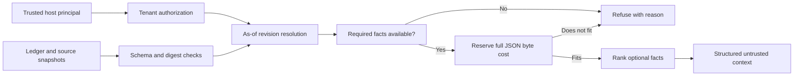

# Decision Memory Lab

**An agent handoff should preserve the decision that matters, along with the evidence that still supports it.**

This independent portfolio experiment by Vedant Thaker builds a small, inspectable memory ledger and a bounded context packer in Python. It keeps explicit revisions, withholds unresolved claims, and reserves space for required facts before ranking optional context. Everything runs locally with the standard library.

## The problem I chose

An agent resumes a grocery-planning investigation. The newest notes are routine status updates. The facts that matter are older: which version to roll back to, and whether launch is still pending. A recent-first context window can spend its entire budget on the wrong information.

Relevance is only part of the problem. A remembered approval may have been withdrawn. A source may have changed. Two records may disagree. Squeezing these records into a smaller prompt does not resolve those conditions.

My decision was to validate the current record first, reserve required facts second, and rank optional context last.

## The framework



- **State before similarity:** explicit supersession determines current versions. A broken, expired, unreviewed, or withdrawn replacement cannot resurrect an older record.
- **Evidence before recall:** SHA-256 checks bind a record to the source snapshot loaded for the run. A digest establishes byte identity, not truth.
- **Required context before convenience:** the entire serialized JSON envelope must fit. If a required fact is missing or too large, the packer returns no partial context.
- **Inspectable budgeting:** the budget is UTF-8 bytes, including JSON overhead. It is not a provider token estimate or a cost measurement.
- **Recall stays data:** output is labeled untrusted. The library has no tool executor and cannot grant permission to send, publish, or deploy.

## Reproduce

Python 3.11 or later. No installation, model download, API key, or cloud account is needed.

```bash
python -m unittest discover -s tests -v
python scripts/run_demo.py
```

To regenerate the fictional dataset:

```bash
python scripts/generate_data.py
python scripts/run_demo.py
```

The [case matrix](results/report.md), [raw results](results/case-results.json), and [metrics](results/metrics.json) are committed. The [example context](results/example-context.json) shows what a resumed worker receives. A trailing newline in the file is an artifact delimiter; the budget applies to the JSON payload before that newline.

## What the experiment supports

Across **14 authored contract cases**, the guarded packer meets **14/14**, compared with **1/14** for an intentionally incomplete recent-first baseline and **10/14** for a stronger validity-aware recent-first ablation. The latter retains source, tenant, state, and minimum-budget checks, but fills context by recency without reserving required facts. It isolates the value of reservation from the validity gates. The cases include version changes, source edits, conflicting leaves, expiry, withdrawal, missing required facts, tenant denial, and a budget that cannot hold required context.

This is a targeted protocol demonstration. Both ablations were written here; neither represents ECC's memory implementation or a claim of general agent accuracy. No LLM answers were evaluated.

The useful outcome is the failure behavior: a handoff that cannot support its required decision stops with an inspectable reason. It does not quietly substitute stale evidence.

## Read the work

- [Case study: from a context problem to a decision contract](docs/case-study.md)
- [Data card and trust boundaries](docs/data-card.md)
- [Implementation](src/decision_memory/ledger.py)
- [Contract tests](tests/test_contracts.py)
- [References and development provenance](docs/provenance.md)

## Limits and next step

This is a local library, not a hosted memory service. The host supplies a trusted principal; this code does not authenticate users. Review status is a dataset assertion, not a signature. Source files are snapshotted at load time and are not continuously monitored. Supersession is explicit and conservative; there is no semantic contradiction detector. The optional greedy ranking is a heuristic, not a knapsack optimum.

The next meaningful evaluation is a blinded set of real handoff tasks with independently annotated required facts, followed by model-answer grading and a proper tokenizer. That would test whether these contracts improve decisions beyond the authored fixtures.
